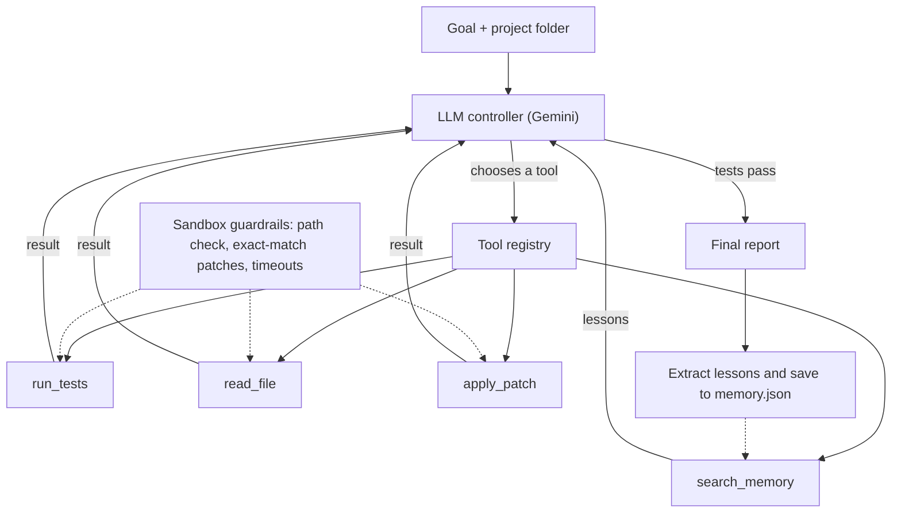

# Code Review and Bug Triage Agent

An LLM-driven agent that finds and fixes bugs in small Python projects. It runs the tests, reads the code, applies patches, re-runs the tests to verify each fix, and records general lessons for later runs.

Built for DAT404 Assignment D (Build, Evaluate and Defend a Custom AI Agent).

## How it works

The agent follows a Perceive, Plan, Act, Verify loop. The LLM (Gemini) chooses which tool to call at every step, and the loop ends when the tests pass or a step limit is reached.



### Tools
| Tool | Purpose |
|---|---|
| `run_tests` | Runs pytest in the project folder (timeout capped at 60 s) |
| `read_file` | Reads a file inside the project folder |
| `apply_patch` | Replaces exact text in one file; refuses if the text is missing or ambiguous |
| `search_memory` | Finds lessons from earlier runs by symptom |

### Memory
After each successful run the LLM writes 1 to 3 general lessons (symptom, cause, fix) with no project-specific names. They are saved to `memory.json` and retrieved by keyword overlap.

### Guardrails
- The sandbox folder is set by the program, not by the LLM, and is not visible to it.
- All three file and test tools refuse paths outside the sandbox (including `..` traversal and similarly named sibling folders).
- Patches apply only when the old text matches exactly once.
- Test runs have a timeout.
- The LLM client throttles calls to respect the free-tier rate limit.

## Setup (Windows PowerShell)

```
python -m venv venv
venv\Scripts\Activate.ps1
pip install -r requirements.txt
```

Create a file named `.env` in the project root containing one line (never commit it):

```
GEMINI_API_KEY=your_key_here
```

The model name is set at the top of `agent/agent.py`.

## Running the agent

```
python run_agent.py sample_project2
```

Add `fail` to make the first patch fail on purpose and watch the agent recover:

```
python run_agent.py sample_project2 fail
```

The agent edits files in place. Restore the planted bugs afterwards with:

```
git checkout sample_project sample_project2 sample_project3 sample_project4
```

## Sample projects

Four small projects with planted bugs, each with its own tests:

| Folder | Bugs |
|---|---|
| `sample_project` | 1 (wrong average) |
| `sample_project2` | 4 (wrong condition, off-by-one, empty input, string splitting) |
| `sample_project3` | 4 defects causing 6 failing tests (float rounding, mutable default, discount maths, formatting); two tests fail only through dependency |
| `sample_project4` | 4 trap bugs (round-half-up, 1-based pages, strict boolean parsing, ordered dedupe) |

## Evaluation

```
python evaluate.py 3
python analyze.py
```

`evaluate.py` runs every project under three conditions, 3 runs each, and writes `results.csv` and a trace per run to `traces/`:

- `baseline`: memory off
- `memory`: memory on, using lessons from the other projects only
- `fault`: memory off, first patch fails on purpose

`analyze.py` prints summary tables, saves `summary.csv` and writes charts to `charts/`. Outages of the LLM service are retried and excluded from the success rate. `results_first_attempt.csv` and `traces_first_attempt/` keep an earlier round that was distorted by free-tier rate limits.

### Results (36 runs, 3 per project and condition)

| Condition | Success | Mean steps | Mean patches | Mean tool errors |
|---|---|---|---|---|
| baseline | 100% | 7.8 | 2.8 | 0.0 |
| memory | 100% | 7.5 | 1.4 | 0.0 |
| fault | 100% | 7.5 | 1.6 | 1.1 |

The agent fixed every project in every run and recovered from all 12 injected tool failures. Memory showed no reliable benefit: the step differences are inside the run-to-run noise.

## Tests

```
python -m pytest tests -q
```

13 tests cover the guardrails. Run them with the `tests` folder named, because the sample projects contain deliberately failing tests.

## Project layout

```
agent/
  agent.py      LLM loop, prompts, rate limiting, lesson extraction
  tools.py      the tools and the sandbox guardrails
  memory.py     lesson storage and retrieval
run_agent.py    run the agent on one project
evaluate.py     evaluation harness
analyze.py      tables and charts
tests/          guardrail tests
experiments/    early test scripts from development (kept as evidence)
results.csv, summary.csv, traces/, charts/    evaluation data
sample_project* projects with planted bugs
```

## Limitations

- Small sample (3 runs per cell), one model, one fault type, synthetic projects.
- All conditions reached 100% success, so success rate cannot separate them (ceiling effect).
- The sandbox is path-based. Patched code is executed by pytest without process-level isolation, so this is not safe for untrusted code.
- Memory is keyword-based and the lessons are written by the same model that uses them.
- Python projects with pytest tests only.

## AI assistance and attribution

This project was developed with step-by-step guidance from an AI assistant (Claude), and the agent itself calls Google's Gemini API. Libraries used: google-genai, python-dotenv, pytest, matplotlib.